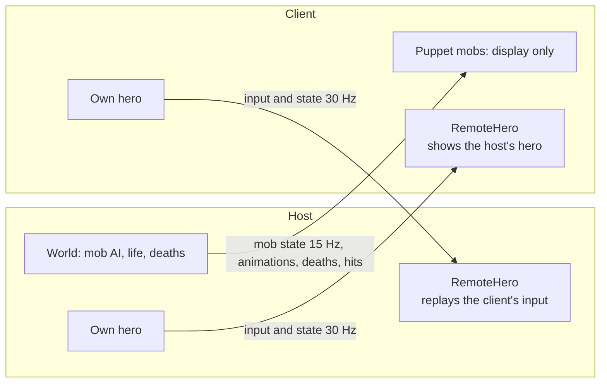

<div align="center">

# Ringo Dead Cells Multiplayer

**Two-player online co-op for Dead Cells: clear biomes together, fight bosses together, take the door together.**

An open-source co-op mod written from scratch on top of [Dead Cells Core Modding](https://github.com/dead-cells-core-modding/core).

**English** · [简体中文](docs/README.zh-CN.md) · [繁體中文](docs/README.zh-TW.md) · [日本語](docs/README.ja.md) · [Русский](docs/README.ru.md) · [Español](docs/README.es.md)

[](https://github.com/Ringophilia/Ringo-DeadCell-MP/releases)
[](LICENSE)


[Features](#features) · [Install](#install) · [How to play](#how-to-play) · [Co-op rules](#co-op-rules) · [Status](#status) · [How it works](#how-it-works) · [Building](#building-from-source) · [Troubleshooting](docs/TROUBLESHOOTING.md)

</div>

> [!WARNING]
> **Early preview.** Every feature passes automated tests that run two games on one machine, but the mod has **not yet been played between two real Steam accounts**, and nobody has finished a full run with it. Expect crashes, failed connections or desyncs, and back up your save first. See [Status](#status).

## Features

| | |
|---|---|
| 🎮 **One shared world** | Each player controls their own hero in the same run; mobs, deaths and drops stay in sync |
| 🏠 **Room lobby** | Pick **Multiplayer** in the main menu to browse friends' and public rooms, then create, join or manage one |
| 👑 **Host controls** | See who is in the room, invite friends, remove a player, lock the room, switch between public and friends only |
| 🚪 **Door gathering** | Press a door to wait at it and cancel any time; you only leave together, through the same door |
| 🛟 **Downed and rescue** | Running out of life puts you down first, and your partner has 30 seconds to get you up; the camera follows them meanwhile |
| 🏷️ **See your partner** | Their name floats above their hero, and they wear their own outfit when your game has it unlocked too |
| ⚖️ **Balanced for two** | Mobs get more life, also when a friend joins mid-level; gear on the ground is shared, scrolls, cells and gold are personal |
| 📈 **Progress-safe** | Runs use the lower progress of the two players, existing unlocks in your save are never rewritten, and new ones are saved as usual |
| 🔌 **Join any time, reconnect** | The host can start alone and a friend joins mid-run; dropped links reconnect; after a crash you return to your level with your gear, and if the host crashes, the friend keeps the room for them |
| 🌐 **13 languages** | The lobby and every message follow the game's language |

## Install

**Both players need:**

1. Dead Cells for PC on Steam, tested on v35.
2. [Dead Cells Core Modding](https://github.com/dead-cells-core-modding/core) (DCCM), tested on 35.14.2.
3. `RingoMP-v0.2.0.zip` from [Releases](https://github.com/Ringophilia/Ringo-DeadCell-MP/releases).
4. Unzip it and put the `RingoMP` folder into `coremod\mods\` inside the game folder:

```text
Dead Cells\
└─ coremod\
   └─ mods\
      └─ RingoMP\
         ├─ RingoMP.dll
         └─ modinfo.json
```

5. Back up your save: `Steam\userdata\<your id>\588650\remote`.
6. Start the game with `coremod\core\host\startup\DeadCellsModding.exe`.

> [!TIP]
> To accept invites **while the game is closed**, set this as the game's launch option in Steam (with your own path). This has not been tested yet:
>
> ```text
> "D:\your path\Dead Cells\coremod\core\host\startup\DeadCellsModding.exe" %command%
> ```

Something not working? See [Troubleshooting](docs/TROUBLESHOOTING.md).

## How to play

1. Choose **Multiplayer** in the main menu to open the lobby.
2. Press **`N`** to create a room, then **`I`** to invite a friend, or press a number to join a listed room.
3. Once your friend is in, the host presses **`S`** for a new run or **`C`** to continue a save, and the friend follows automatically.

| Key | Room list | In a room |
|---|---|---|
| `N` / `R` | Create a room / refresh | |
| `1`–`9` | Join that room | |
| `S` / `C` | | New run / continue save (host) |
| `I` | | Invite a friend |
| `K` | | Remove the player (host) |
| `L` | | Lock or unlock (host) |
| `P` | Visibility of new rooms | Visibility (host) |
| `X` | | Close the room (host) / leave |
| `Esc` | Back | Back |
| `F5` | Open or hide the lobby at any time, also during a run | |

## Co-op rules

**Leaving a level**

- Pressing a door makes you wait there. Press again or walk 3 cells away to cancel, so a mistaken press costs nothing.
- If you wait at different doors, nobody leaves. Meet at the same door to go on together.
- Ways out without a door, like falls and hidden passages, take one player first and the other follows automatically.

**Dying**

- When you go down, your partner stands next to you and holds interact for 1.5 seconds to get you up with half your life. Your camera follows them while you wait.
- If nobody gets you up within 30 seconds, you come back in the next level.
- The run only ends when both players are down.

**Resources**

| Resource | Rule |
|---|---|
| Scrolls, cells, gold | One each, everyone picks up their own |
| Weapons, skills and amulets on the ground | Shared: when one player takes it, it is gone for the other; what you swap out stays on the ground for your partner |
| Starting armory | Each player picks their own |
| Mob drops | One each |

**Mob strength** (starting values, to be tuned after real play)

| Kind | Life | Damage |
|---|---|---|
| Regular | ×1.5 | Unchanged |
| Elite | ×1.7 | Unchanged |
| Boss | ×1.8 | Unchanged |

**Progress**

- A run uses the lower progress of the two players: the unlocks both have, and the fewer boss cells. That is what lets both games build the same levels.
- This only affects what is loaded. Unlocks already in your save are never rewritten, and what you unlock during the run is saved by the game as usual, into each player's own save.

## Status

**Passing automated tests** (two games on one machine, some with 5% packet loss and 80 ms lag)

- [x] Heroes, mobs, animations and hits in sync
- [x] Door gathering, cancelling, different doors, several levels in a row
- [x] Going down, rescue, coming back after the window, a new run after a wipe
- [x] Shared gear, swapped-out gear
- [x] The same levels at the lower progress (simulated on one save)
- [x] Reconnecting after a dropped link, going on alone after the partner leaves
- [x] Joining mid-run, coming back after a crash with your gear
- [x] Creating and listing rooms on real Steam
- [x] All menu text in 13 languages fits the game's fonts

**Not verified yet**

- [ ] P2P connections and invites between two real Steam accounts
- [ ] A full run played by people
- [ ] How the lobby looks and responds to keys on a real screen
- [ ] Writing and reading back a real save in co-op
- [ ] Normal boss fights against the Giant, the Queen, Dooku and the Collector
- [ ] The host taking a room back after a crash, and meeting in the level of a continued save (written, not tested yet)
- [ ] The partner's outfit on screen

**Known limits**

- Two players at most, main game only: no daily challenge or Boss Rush.
- A player coming back gets the items and gold they had when entering the level, but not weapon affixes.
- The bank and some side rooms are not adapted yet.

Issues are welcome on [GitHub](https://github.com/Ringophilia/Ringo-DeadCell-MP/issues). Please attach the newest log from `coremod\logs`.

## How it works

Dead Cells makes about 15,600 random calls without a seed, and its levels also depend on what is in the save, so lockstep is out. In this mod **the host owns the world, and each player owns their hero**:



- **The same levels:** both games build each level from the same seed, and a signature over its mobs and items proves they match.
- **The second hero:** `RemoteHero` extends the game's own `Beheaded` and is driven by a virtual gamepad, so weapons and skills run the original code.
- **Mob targets:** mob code reads `game.hero` in about 500 places. `HeroFocus` swaps in the nearest player while a mob runs.
- **Joining mid-run:** what a level holds depends on the way there, so a new player walks the host's route level by level, then gets the mobs already dead and the items already moved. A continued save gives its route from the save itself, and the level the host left is trimmed to match.
- **Network:** Steam's `ISteamNetworkingSockets`, with Steam's relays when P2P fails. Rooms are Steam lobbies.

| Path | Contents |
|---|---|
| [`mod/RingoMP`](mod/RingoMP) | The mod: heroes, lobby, main menu, translations |
| [`mod/RingoMP/Net`](mod/RingoMP/Net) | Networking: sync, gathering, rescue, items, progress, transport |
| [`mod/RingoMP/Dev`](mod/RingoMP/Dev) | Automated test scenarios |
| [`tools`](tools) | Test scripts and bytecode tools |
| [`crates`](crates) | An early Rust loader prototype, not used by the current version |

## Building from source

You need Windows, the [.NET 10 SDK](https://dotnet.microsoft.com/download) and an installed DCCM.

```powershell
$env:DCCM_MDK_ROOT = "D:\your path\Dead Cells\coremod\core\mdk"
dotnet nuget add source "$env:DCCM_MDK_ROOT\packages" --name DeadCoreModdingMDK
dotnet build mod\RingoMP\RingoMP.csproj
```

The build installs the mod into `coremod\mods` by itself.

The test scripts start two games on a hidden Windows desktop: no windows, no stolen focus, and no writes to your save. Steam must be running.

```powershell
$env:DEADCELLS_DIR = "D:\your path\Dead Cells"
tools\net.ps1 240 gather   # door gathering and several levels in a row
tools\net.ps1 240 team     # going down, rescue, shared items
tools\join.ps1             # joining mid-run and coming back after a crash
tools\lobby.ps1            # rooms and lobby
python -I tools\fontcheck.py "$env:DEADCELLS_DIR\res.pak" mod\RingoMP\Translations.cs
```

**Translations** live in [`Translations.cs`](mod/RingoMP/Translations.cs), one column per game language. `tools\fontcheck.py` checks each one against that language's game font, since a letter the font lacks would simply not show. Corrections from native speakers are very welcome.

## Credits

- [Dead Cells Core Modding](https://github.com/dead-cells-core-modding/core): the modding framework that makes this possible
- [Steamworks.NET](https://github.com/rlabrecque/Steamworks.NET): Steam bindings
- [Motion Twin](https://motion-twin.com/) and [Evil Empire](https://evilempire.games/), for such a great game

This project was written from scratch and uses no code from other multiplayer mods.

## Disclaimer

This is an unofficial fan project, not affiliated with Motion Twin, Evil Empire or Playdigious. The repository contains no game code or assets, and you need your own copy of the game. The mod is provided as is; back up your save before use. See [LICENSE](LICENSE).
