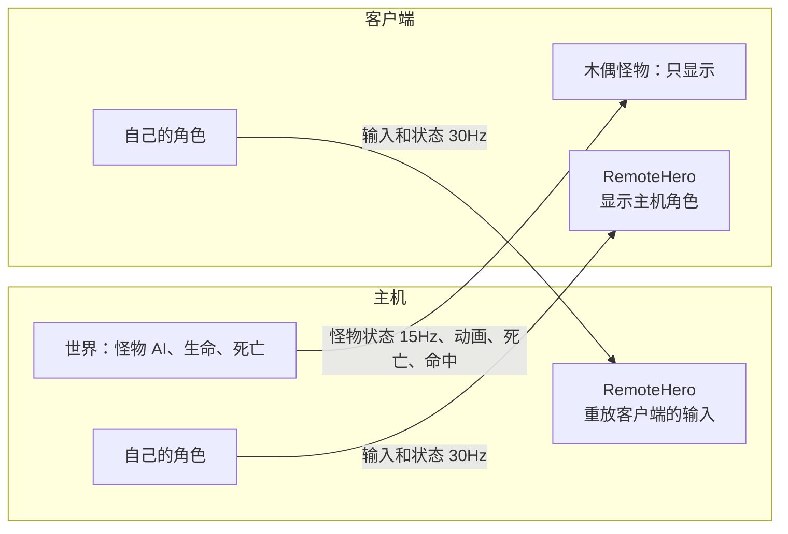

<div align="center">

# Ringo Dead Cells Multiplayer

**给《死亡细胞》加上双人联机：一起闯关，一起打 Boss，一起进门。**

从零编写的开源联机 Mod，基于 [Dead Cells Core Modding](https://github.com/dead-cells-core-modding/core)。

[English](../README.md) · **简体中文** · [繁體中文](README.zh-TW.md) · [日本語](README.ja.md) · [Русский](README.ru.md) · [Español](README.es.md)

[](https://github.com/Ringophilia/Ringo-DeadCell-MP/releases)
[](../LICENSE)


[功能](#功能) · [安装](#安装) · [怎么玩](#怎么玩) · [联机规则](#联机规则) · [项目状态](#项目状态) · [工作原理](#工作原理) · [从源码构建](#从源码构建) · [常见问题](TROUBLESHOOTING.zh-CN.md)

</div>

> [!WARNING]
> **这是早期预览版。** 所有功能都通过了本机双开的自动化测试，但**还没有在两个真实 Steam 账号之间联机过**，也没有人完整打通过一局。可能遇到崩溃、连不上或不同步。开始前请备份存档，详见[项目状态](#项目状态)。

## 功能

| | |
|---|---|
| 🎮 **同一个世界** | 两人在同一局里各控制一个角色，怪物、死亡、掉落都保持同步 |
| 🏠 **房间大厅** | 主菜单选“多人游戏”进入大厅，查看好友和公开房间，新建、加入或管理房间 |
| 👑 **房主管理** | 查看成员、邀请好友、移出玩家、锁定房间、切换公开或好友可见 |
| 🚪 **进门集合** | 按门后在门口等待，可随时取消；两人到同一扇门才一起进入下一关 |
| 🛟 **倒地救援** | 血量耗尽先倒地，队友 30 秒内可以救起；等待期间镜头跟着队友 |
| 🏷️ **看得见队友** | 队友头顶显示名字；你也解锁了队友的服装时，队友会穿着自己的服装 |
| ⚖️ **双人平衡** | 怪物血量按人数提高，朋友中途加入时当前关也会生效；地面装备共享，卷轴、细胞和金币各拿各的 |
| 📈 **进度保护** | 按两人中较低的进度生成关卡；不改写存档里已有的解锁，局内新解锁照常保存 |
| 🔌 **随时加入与重连** | 主机可以先玩，朋友中途加入；断线自动重连，崩溃后回到原关并恢复装备；房主崩溃时，朋友会替房主保留房间 |
| 🌐 **13 种语言** | 大厅和所有提示跟随游戏语言 |

## 安装

**两位玩家都需要：**

1. 正版《死亡细胞》PC 版（Steam），已在 v35 上测试。
2. 安装 [Dead Cells Core Modding](https://github.com/dead-cells-core-modding/core)（已在 35.14.2 上测试）。
3. 从 [Releases](https://github.com/Ringophilia/Ringo-DeadCell-MP/releases) 下载 `RingoMP-v0.3.0.zip`。
4. 把解压出的 `RingoMP` 文件夹放进游戏目录下的 `coremod\mods\`：

```text
Dead Cells\
└─ coremod\
   └─ mods\
      └─ RingoMP\
         ├─ RingoMP.dll
         └─ modinfo.json
```

5. 备份存档：`Steam\userdata\<你的ID>\588650\remote`。
6. 运行 `coremod\core\host\startup\DeadCellsModding.exe` 启动游戏。

> [!TIP]
> 想让朋友**在游戏没打开时**也能直接接受邀请，请在 Steam 的游戏属性里把启动选项设为下面这行（路径换成你自己的）。这项还没有实测：
>
> ```text
> "D:\你的路径\Dead Cells\coremod\core\host\startup\DeadCellsModding.exe" %command%
> ```

遇到问题？请看[常见问题](TROUBLESHOOTING.zh-CN.md)。

## 怎么玩

1. 主菜单选择 **多人游戏**，进入大厅。
2. 选择 **创建房间**，再选 **邀请好友**；或者直接选列表里的房间加入。
3. 朋友加入后，房主选择 **开始新游戏** 或 **继续存档**，朋友会自动跟上。

大厅和游戏的设置菜单是同一种界面：可以用鼠标点，也可以用键盘或手柄移动、确认，和游戏里其他菜单一样。局内的暂停菜单里也有 **多人游戏**，打开的是同一个大厅，可以邀请好友、锁定或退出房间。

## 联机规则

**过关**

- 按门后进入等待，再按一次或走开 3 格就取消，误按没有代价。
- 两人在不同的门等待时都不会走，走到同一扇门才一起出发。
- 掉落、隐藏通道这类不走门的路线，一个人走后另一个人会自动跟上。
- 进出子房间（挑战房、银行等）的门也一样：两人一起进去，一起出来。

**死亡**

- 倒地后，队友靠近并按住交互键 1.5 秒救起，恢复一半血量。等待期间你的镜头跟着队友。
- 30 秒内没救起，下一关自动复活。
- 只有两人都倒下，这一局才结束。

**资源**

| 资源 | 规则 |
|---|---|
| 卷轴、细胞、金币 | 每人一份，各拿各的 |
| 地面的武器、技能、护符 | 共享，一人拿走另一边消失；换下的装备会留在地上给队友 |
| 开局军械库 | 各选各的 |
| 怪物掉落 | 每人一份 |

**怪物强度**（起始值，会根据实测调整）

| 类型 | 血量 | 伤害 |
|---|---|---|
| 普通怪 | ×1.5 | 不变 |
| 精英 | ×1.7 | 不变 |
| Boss | ×1.8 | 不变 |

**进度**

- 一局按两人中较低的进度来：取解锁的交集和较少的 Boss 细胞，这样两边才能生成相同的关卡。
- 这只影响读取，不改写存档里已有的解锁；局内新解锁的内容走游戏原本的保存流程，存进各自的存档。

## 项目状态

**已通过自动化测试**（本机双开，部分带 5% 丢包和 80ms 延迟）

- [x] 角色、怪物、动画、受击同步
- [x] 进门集合、取消、不同门分流、连续过关
- [x] 倒地、救援、超时复活、全灭后开新局
- [x] 共享装备、换下的装备
- [x] 按最低进度生成相同关卡（在一份存档上模拟）
- [x] 断线重连、对方离开后继续单人
- [x] 中途加入、崩溃后回来并恢复装备和附加词条
- [x] 两人一起进出子房间，双方保持同步
- [x] 真实 Steam 上创建房间、列出房间
- [x] 主菜单和暂停菜单里的大厅（测试会截图检查）
- [x] 13 种语言的菜单文字都能用游戏字体显示

**尚未验证**

- [ ] 两个真实 Steam 账号之间的 P2P 连接和邀请
- [ ] 真人完整打通一局
- [ ] 用真实鼠标和手柄操作大厅
- [ ] 银行和所有类型的子房间（目前用第一关的子房间测试）
- [ ] 联机时写入并读回真实存档
- [ ] Giant、Queen、Dooku、Collector 的正常入场战斗
- [ ] 房主崩溃后回到房间、在继续的存档里当关汇合（已实现，尚未测试）
- [ ] 队友服装的实际显示

**已知限制**

- 目前最多 2 人。
- 只支持主线，不含每日挑战、Boss Rush 和自定义模式。

欢迎提 [Issue](https://github.com/Ringophilia/Ringo-DeadCell-MP/issues)，请附上 `coremod\logs` 里最新的日志。

## 工作原理

《死亡细胞》全局有约 15600 处不带种子的随机调用，关卡生成还依赖存档内容，所以不能用帧同步。这个 Mod 的做法是**主机拥有世界，每位玩家拥有自己的角色**：



- **相同的关卡：** 两边用同一个种子生成，并用怪物和物品算出的签名确认一致。
- **第二个角色：** `RemoteHero` 继承游戏自己的 `Beheaded`，用虚拟手柄驱动，所以武器和技能都走原版逻辑。
- **怪物的目标：** 怪物代码在约 500 处读取 `game.hero`，`HeroFocus` 在怪物运行时把它临时换成最近的玩家。
- **中途加入：** 关卡内容和走过的路线有关，所以新玩家会按主机的路线逐关走到当前关，再补上已死的怪和被动过的物品。继续存档时路线直接从存档读取，房主当前关少掉的怪物和物品也会在朋友这边同样移除。
- **网络：** 使用 Steam 的 `ISteamNetworkingSockets`，P2P 失败时走 Steam 中继；房间就是 Steam 大厅。

| 路径 | 内容 |
|---|---|
| [`mod/RingoMP`](../mod/RingoMP) | Mod 本体：角色、大厅、主菜单、翻译 |
| [`mod/RingoMP/Net`](../mod/RingoMP/Net) | 网络层：同步、集合、救援、物品、进度、传输 |
| [`mod/RingoMP/Dev`](../mod/RingoMP/Dev) | 自动化测试场景 |
| [`tools`](../tools) | 测试脚本和字节码分析工具 |
| [`crates`](../crates) | 早期的 Rust 加载器原型，当前版本不使用 |

## 从源码构建

需要 Windows、[.NET SDK 10](https://dotnet.microsoft.com/download)，以及已安装的 DCCM。

```powershell
$env:DCCM_MDK_ROOT = "D:\你的路径\Dead Cells\coremod\core\mdk"
dotnet nuget add source "$env:DCCM_MDK_ROOT\packages" --name DeadCoreModdingMDK
dotnet build mod\RingoMP\RingoMP.csproj
```

构建完成后，Mod 会自动装进 `coremod\mods`。

测试脚本会在一个隐藏的 Windows 桌面上启动两个游戏，不弹窗、不抢焦点，也不会写入存档。需要 Steam 正在运行：

```powershell
$env:DEADCELLS_DIR = "D:\你的路径\Dead Cells"
tools\net.ps1 240 gather   # 进门集合与连续过关
tools\net.ps1 240 team     # 倒地、救援、共享物品
tools\join.ps1             # 中途加入与崩溃回归
tools\lobby.ps1            # 房间和大厅
python -I tools\fontcheck.py "$env:DEADCELLS_DIR\res.pak" mod\RingoMP\Translations.cs
```

**翻译**都在 [`Translations.cs`](../mod/RingoMP/Translations.cs) 里，每种游戏语言一列。`tools\fontcheck.py` 会用各语言的游戏字体逐字检查，因为字体里没有的字在游戏里会直接显示不出来。欢迎母语玩家帮忙修正。

## 致谢

- [Dead Cells Core Modding](https://github.com/dead-cells-core-modding/core)：让这一切成为可能的 Mod 框架
- [Steamworks.NET](https://github.com/rlabrecque/Steamworks.NET)：Steam 接口绑定
- [Motion Twin](https://motion-twin.com/) 和 [Evil Empire](https://evilempire.games/)：做出了这么好的游戏

本项目从零编写，没有使用其他多人 Mod 的代码。

## 免责声明

这是非官方的粉丝项目，与 Motion Twin、Evil Empire 和 Playdigious 没有关联。仓库不包含任何游戏代码或资源，你需要自己拥有正版游戏。Mod 按“现状”提供，使用前请备份存档，详见 [LICENSE](../LICENSE)。
